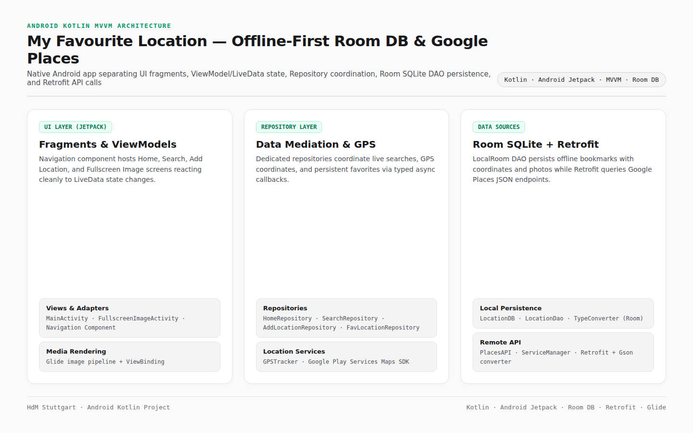
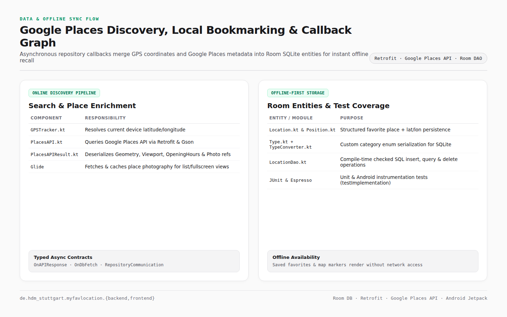

<!-- portfolio:date=2020-07-14 -->
# My Favourite Location

**[English](README.md) · [Deutsch](README.de.md)**

<p align="center"></p>

Eine native Android-App in Kotlin mit MVVM-Architektur, lokalem Room-DB-Speicher, Retrofit und Google Places API zum Entdecken, Kartieren und Speichern von Lieblingsorten.

## Highlights

- **Klare MVVM- & Android-Jetpack-Architektur** — trennt Jetpack-Navigation-Fragmente, `ViewModel`/`LiveData`-Zustände und vier spezialisierte Repositories (`HomeRepository`, `SearchRepository`, `AddLocationRepository`, `FavLocationRepository`).
- **Offline-First mit Room DB & Google Places API** — speichert Favoriten samt Position über `LocationDB` und typgeprüfte `LocationDao`-Abfragen (`Room DB`), während `Retrofit` + Gson und `GPSTracker` Orte über die `Google Places API` laden.
- **Bild-Caching & Android-Testsuite** — lädt Ortsfotos performant mit `Glide`, zeigt Marker auf Google Maps und enthält JUnit- sowie Espresso-UI-Tests.

## Screenshots

<p align="center">
  
</p>

## Architektur

```
Jetpack-Navigation-Fragmente + ViewBinding (Home · Suche · Hinzufügen · Karte · Vollbild)
         │  ViewModel + LiveData
         ▼
Repositories (Home · Search · AddLocation · FavLocation + Callbacks)
         ├──► Room DB (LocationDB · LocationDao · TypeConverter ──► Lokales SQLite)
         └──► Retrofit + PlacesAPI + GPSTracker ──► Google Places API + Glide
```

## Tech-Stack

Kotlin · Android · Android Jetpack · MVVM · Room DB · Retrofit · Google Places API · Glide · Google Maps SDK · JUnit · Espresso

## Einrichtung

```bash
./gradlew assembleDebug    # In Android Studio öffnen oder Debug-APK bauen (Google-API-Key nötig)
./gradlew test             # Lokale JUnit-Tests ausführen
```
