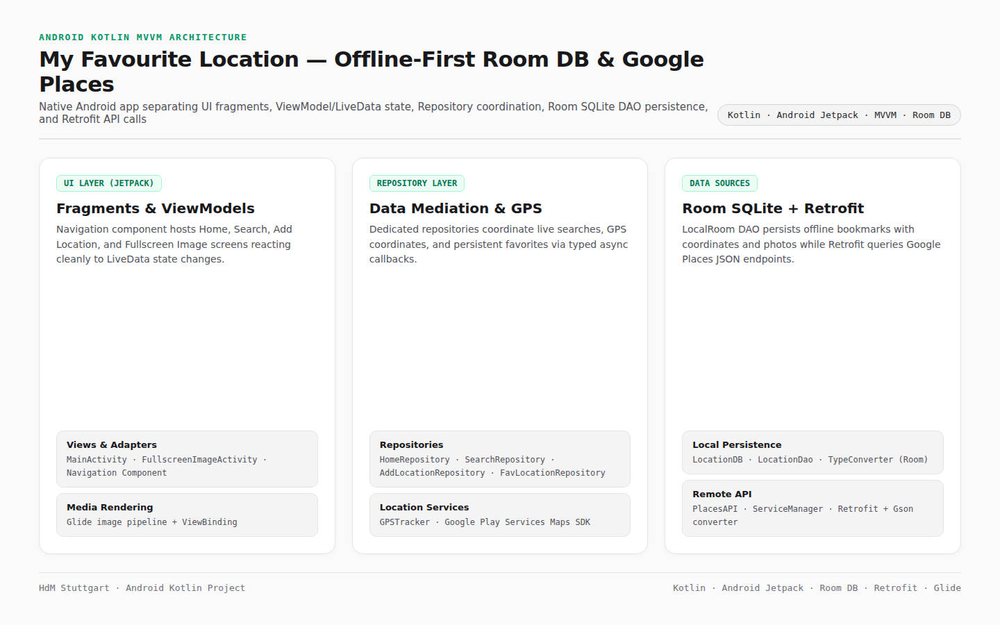
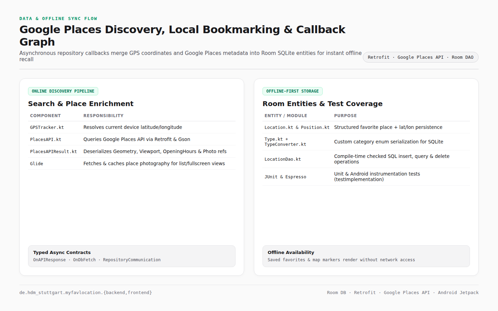

<!-- portfolio:date=2020-07-14 -->
# My Favourite Location

**[English](README.md) · [Deutsch](README.de.md)**

<p align="center"></p>

A native Kotlin Android application built with MVVM architecture, Room DB offline storage, Retrofit, and the Google Places API to discover, map, and bookmark favourite places.

## Highlights

- **Clean MVVM + Android Jetpack architecture** — separates Jetpack Navigation fragments, `ViewModel` / `LiveData` state, and four domain repositories (`HomeRepository`, `SearchRepository`, `AddLocationRepository`, `FavLocationRepository`).
- **Offline-first Room DB & Google Places sync** — persists bookmarked places locally through `LocationDB` and compile-time checked `LocationDao` queries (`Room DB`), while `Retrofit` + Gson and `GPSTracker` query nearby venues via the `Google Places API`.
- **Media caching & automated Android tests** — loads place photography smoothly with `Glide`, renders interactive Google Maps pins, and includes JUnit and Espresso instrumentation tests.

## Screenshots

<p align="center">
  
</p>

## Architecture

```
Jetpack Navigation Fragments + ViewBinding (Home · Search · Add · Map · Fullscreen Image)
         │  ViewModel + LiveData
         ▼
Repositories (Home · Search · AddLocation · FavLocation + Typed Callbacks)
         ├──► Room DB (LocationDB · LocationDao · TypeConverter ──► Local SQLite)
         └──► Retrofit + PlacesAPI + GPSTracker ──► Google Places API + Glide Images
```

## Tech Stack

Kotlin · Android · Android Jetpack · MVVM · Room DB · Retrofit · Google Places API · Glide · Google Maps SDK · JUnit · Espresso

## Getting Started

```bash
./gradlew assembleDebug    # Open in Android Studio or build debug APK (requires Google Maps/Places API key)
./gradlew test             # Run local JUnit tests
```
